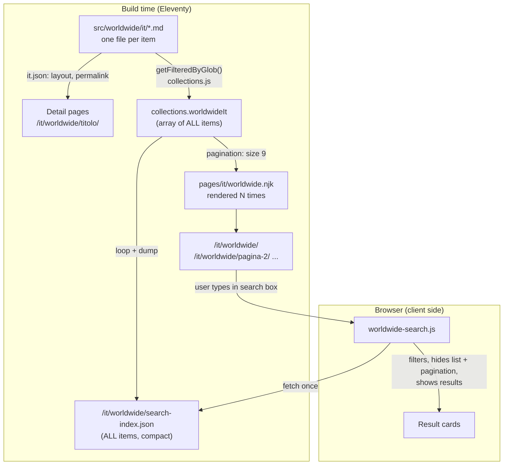

# How Eleventy Works — Developer & Editor Guide

A practical reference for adding pages, sections, components, translations, and blog posts to this site.

---

## Table of Contents

1. [How Eleventy processes your files](#1-how-eleventy-processes-your-files)
2. [Project structure explained](#2-project-structure-explained)
3. [How to add a new page](#3-how-to-add-a-new-page)
4. [How to add a new section to an existing page](#4-how-to-add-a-new-section-to-an-existing-page)
5. [How to create a new WebC component](#5-how-to-create-a-new-webc-component)
6. [How to edit navigation](#6-how-to-edit-navigation)
7. [How to add or edit translations](#7-how-to-add-or-edit-translations)
8. [How to add a new language](#8-how-to-add-a-new-language)
9. [How to write and publish blog posts](#9-how-to-write-and-publish-blog-posts)
10. [How design tokens work](#10-how-design-tokens-work)
11. [How the CSS pipeline works](#11-how-the-css-pipeline-works)
12. [Common front matter fields reference](#12-common-front-matter-fields-reference)
13. [How permalinks work](#13-how-permalinks-work)
14. [How to build a listing page with pagination and client-side search](#14-how-to-build-a-listing-page-with-pagination-and-client-side-search)

---

## 1. How Eleventy processes your files

When you run `npm start` or `npm run build`, the following happens in order:

1. **CSS build** — PostCSS reads `src/assets/css/*.css`, runs Tailwind CSS, autoprefixer, and cssnano, and writes compiled output used by the templates.
2. **JS build** — esbuild bundles scripts from `src/assets/scripts/`.
3. **Eleventy** — processes all `.md`, `.njk`, and `.webc` files under `src/`, applying layouts, data, filters, and shortcodes, then writes the final HTML to `dist/`.

Output folder: `dist/`
Dev server URL: `http://localhost:8080`

### Data cascade

Every page in Eleventy has access to data from multiple sources, merged in this order (highest priority first):

1. Front matter in the file itself
2. Directory data files (e.g. `src/posts/posts.json`)
3. Global data files (e.g. `src/_data/meta.js`)

This means a value in a page's front matter always wins over a global default.

### Global data (`src/_data/`)

Every file in `src/_data/` is loaded automatically and exposed to **all** templates (layouts, partials, pages) as a global variable. No import or configuration is needed. The input folder is `src` (see `eleventy.config.js`), so Eleventy reads `src/_data/`.

**The variable name is the file name without extension.**

| File | Variable in templates |
|---|---|
| `src/_data/navigation.js` | `navigation` |
| `src/_data/meta.js` | `meta` |
| `src/_data/personal.yaml` | `personal` |
| `src/_data/helpers.js` | `helpers` |
| `src/_data/translations/it.js` | `translations.it` (subfolders become nested objects) |

How the content of a JS file is exposed:

- **`export default`**: the exported value becomes the variable. Example: `navigation.js` → `navigation.top`, `navigation.bottom`.
- **Named exports only** (no `export default`): Eleventy collects them into one object named after the file. Example: in `meta.js`, `export const easteregg = true;` is available as `meta.easteregg`, **not** as `easteregg`. Likewise `meta.navigation.ariaBottom` (a named export of `meta.js`) is different from `navigation` (the file `navigation.js`).
- **Both default and named exports**: only the default is used; named exports are ignored.
- **No export**: nothing is exposed. Variables and functions inside the file stay private to the module.

JSON and YAML files work the same way (file name → variable name).

Global data has the **lowest priority** in the cascade: front matter and directory data files (e.g. `it.json`) override it. For example, `lang` set in `src/pages/it/it.json` is read as `lang`, while the global value is read as `meta.lang`; the two do not overwrite each other. Templates in this project use `lang or meta.lang` to fall back to the global value.

`page` (current page info such as `page.url`) is not part of `_data/`: it is provided by Eleventy itself.

### Data that does not come from `src/_data/`

Some variables used in templates are not defined in `_data/`. Do not look for a file with that name.

**Supplied by Eleventy**

| Variable | Content |
|---|---|
| `page` | Current page info: `url`, `fileSlug`, `inputPath`, `outputPath`, `date`. |
| `collections` | All collections: `collections.all`, `collections.allPosts`, tag collections, and those defined in `src/_config/collections.js`. |
| `eleventy` | Build info: `eleventy.version`, `eleventy.generator`, `eleventy.env`, `eleventy.directories`. |
| `pkg` | Contents of `package.json`. Used in the footer (`pkg.version`) and in `edit-on.njk` (`pkg.repository.url`). |
| `content` | Already rendered HTML of the page, available in layouts: `{{ content | safe }}`. |

**Reserved keys**

When set in front matter, directory data files (e.g. `it.json`) or `_data/`, these keys configure Eleventy itself: `layout`, `permalink`, `tags`, `date`, `eleventyExcludeFromCollections`, `eleventyComputed`, `eleventyNavigation`, `pagination`.

**Added via configuration**

`eleventyConfig.addGlobalData()` creates global data without a file in `_data/`. This project uses it in `src/_config/plugins/drafts.js` to set `eleventyComputed.permalink` and `eleventyComputed.eleventyExcludeFromCollections`.

**Filters and shortcodes (not data)**

``, `` and `| slugify` are defined in `src/_config/` and use a different syntax from variables.

---

## 2. Project structure explained

```
src/
├── _config/        Configuration: collections, filters, plugins, build events
├── _data/          Global data available in every template
├── _includes/      Partials, components, head fragments, CSS, scripts
│   ├── head/       Fragments included in <head> (SEO, CSS injection, etc.)
│   ├── partials/   Shared Nunjucks fragments (header, footer, nav, etc.)
│   ├── webc/       Reusable WebC components (.webc)
│   ├── css/        Per-page CSS files (inlined at build time)
│   └── scripts/    Per-page JS files (inlined at build time)
├── _layouts/       Page layouts (base.njk, page.njk, post.njk, tags.njk)
├── assets/         Static assets (CSS source, fonts, images, SVGs)
├── common/         Site-wide files (sitemap, robots.txt, RSS feed, 404)
├── pages/          All site pages
│   ├── it/         Italian pages (+ it.json data file)
│   ├── en/         English pages (+ en.json data file)
│   └── *.md|njk    Language-neutral pages (privacy, accessibility, blog...)
└── posts/          Blog posts
```

**Key rule:** layouts live in `src/_layouts/`, not inside `_includes/`. All other reusable fragments live inside `src/_includes/`.

---

## 3. How to add a new page

### Simple content page (Markdown)

1. Create the file in the appropriate language folder:

```
src/pages/it/my-new-page.md
src/pages/en/my-new-page.md
```

2. Add front matter at the top:

```yaml
---
title: My New Page
description: A short description for SEO.
layout: page
---

Your content here in **Markdown**.
```

The `permalink` is set automatically by the language directory data file (`it.json` / `en.json`):
- Italian page → `/it/my-new-page/`
- English page → `/en/my-new-page/`

For a **language-neutral page** (same URL for every language, e.g. privacy), create
the file directly in `src/pages/` and set an explicit `permalink` (see §13).

### Page with template logic (Nunjucks)

Use `.njk` instead of `.md` when you need loops, conditionals, or include other partials:

```
src/pages/it/progetti.njk
```

```njk
---
title: Progetti
layout: page
---

<div class="wrapper">
  
    <p>{{ project.name }}</p>
  
</div>
```

### Override the permalink

To set a custom URL, add `permalink` to the front matter:

```yaml
---
title: Home
permalink: /it/
---
```

---

## 4. How to add a new section to an existing page

### In a Markdown page

Sections in Markdown pages are written as regular Markdown content. If you need a more structured HTML layout, switch the file to `.njk`.

### In a Nunjucks page

Add a `<section>` block directly in the `.njk` file. Example:

```njk
<section class="full | region">
  <div class="wrapper flow">
    <h2>New section title</h2>
    <p>Section content.</p>
  </div>
</section>
```

### Using a WebC component

If the section will be reused across pages, turn it into a WebC component (see §5) and use the tag in the page:

```njk
<impact-stats></impact-stats>
```

### Layout utilities (CSS classes)

The template uses a set of layout utility classes from the design system:

| Class | Effect |
|---|---|
| `wrapper` | Centered container with max-width |
| `region` | Vertical padding (responsive) |
| `flow` | Vertical spacing between children |
| `full` | Full-width bleed (breaks out of wrapper) |
| `cluster` | Horizontal flex group |
| `grid` | Auto-fill grid |
| `prose` | Readable text column with comfortable width |

---

## 5. How to create a new WebC component

WebC components colocate HTML, CSS, and JS in a single `.webc` file.

### 1. Create the file

```
src/_includes/webc/custom-impact-stats.webc
```

### 2. Write the component

```html
<section class="impact-stats | region wrapper" webc:root>
  <ul class="cluster" role="list">
    <li>
      <strong>250+</strong>
      <span @text="t.impact.volunteers"></span>
    </li>
    <li>
      <strong>45</strong>
      <span @text="t.impact.projects"></span>
    </li>
  </ul>
</section>

<style webc:scoped>
  .impact-stats strong {
    font-size: var(--size-fluid-4);
  }
</style>
```

Key WebC attributes:

| Attribute | Effect |
|---|---|
| `webc:root` | Applies the component's classes to the root element |
| `webc:scoped` | Scopes the `<style>` block to this component only |
| `@text="expr"` | Sets the text content from a JS expression |
| `@html="expr"` | Sets inner HTML from a JS expression |
| `:attr="expr"` | Binds an HTML attribute dynamically |
| `<slot>` | Inserts slotted content passed by the caller |

### 3. Use the component in a page

WebC components registered in `src/_includes/webc/` are automatically available by their filename:

```html
<!-- in any .njk or .webc page -->
<custom-impact-stats></custom-impact-stats>
```

No import is needed.

---

## 6. How to edit navigation

Navigation items are defined in `src/_data/navigation.js`:

```js
export default {
  top: [
    { text: 'Home',     url: '/it/' },
    { text: 'About',    url: '/it/about/' },
    { text: 'Projects', url: '/it/projects/' }
  ],
  bottom: [
    { text: 'Privacy',  url: '/it/privacy/' }
  ]
};
```

- `top` → items shown in the main header navigation
- `bottom` → items shown in the footer

For a multilingual site, use translation keys instead of hardcoded text and resolve them in the partial (see §7).

---

## 7. How to add or edit translations

Translation files live in `src/_data/translations/`:

```
src/_data/translations/it.js   ← Italian
src/_data/translations/en.js   ← English
```

Each file exports a plain object with UI strings organized by section:

```js
// src/_data/translations/it.js
export default {
  nav: {
    home: 'Home',
    about: 'Chi siamo',
    projects: 'Progetti'
  },
  common: {
    learnMore: 'Scopri di più',
    donate: 'Dona ora'
  },
  impact: {
    volunteers: 'Volontari',
    projects: 'Progetti',
    helped: 'Persone aiutate',
    countries: 'Paesi'
  }
};
```

**Rules:**
- Only put UI strings here (labels, buttons, generic headings)
- Page-specific content (body text, descriptions) belongs in the Markdown/Nunjucks content files
- Keep the same key structure across all language files

### Using translations in templates

Make the translation object available to a layout by loading the right file based on `lang`:

```njk
{# in a layout or partial #}

<button>{{ t.common.donate }}</button>
```

---

## 8. How to add a new language

1. **Register the language** in `src/_data/languages.js`:

```js
export default [
  { code: 'it', label: 'Italiano', default: true },
  { code: 'en', label: 'English',  default: false },
  { code: 'fr', label: 'Français', default: false }   // new
];
```

2. **Create the language folder** and directory data file:

```
src/pages/fr/fr.json
```

```json
{
  "lang": "fr",
  "locale": "fr_FR",
  "permalink": "/fr/{{ page.fileSlug }}/"
}
```

3. **Add a translation file**:

```
src/_data/translations/fr.js
```

Copy the structure from `it.js` and translate all values.

4. **Add content pages**:

```
src/pages/fr/index.md
src/pages/fr/about.md
```

---

## 9. How to write and publish blog posts

### File location and naming convention

Posts live in `src/posts/` organized by year:

```
src/posts/2025/my-post-title.md
```

Use a date prefix for easy sorting:

```
src/posts/2025/2025-08-04-my-post-title.md
```

Posts with images can be a folder:

```
src/posts/2025/2025-08-04-my-post-title/
    index.md
    cover.jpg
```

### Front matter

```yaml
---
title: 'My Post Title'
description: 'A short description for SEO and feed readers.'
date: 2025-08-04
tags:
  - announcements
  - projects
---
```

| Field | Required | Description |
|---|---|---|
| `title` | Yes | Post title |
| `description` | Recommended | Used for SEO and RSS feed |
| `date` | Yes | Publication date (YYYY-MM-DD) |
| `tags` | Optional | Array of topic tags |
| `draft: true` | Optional | Hides the post from production build |

### Post URL

The URL is generated automatically from the title via the `slugify` filter, as defined in `src/posts/posts.json`:

```
/blog/my-post-title/
```

### Drafts

Add `draft: true` to the front matter to exclude a post from the production build while keeping it in the repository:

```yaml
---
draft: true
---
```

---

## 10. How design tokens work

Design tokens are the single source of truth for colors, spacing, typography, and more.

### Token files

```
src/_data/designTokens/
├── colors.json       Color palette
├── colorsBase.json   Base color values (used to generate the palette)
├── fonts.json        Font families
├── spacing.json      Spacing scale
├── textSizes.json    Font size scale
├── textLeading.json  Line height scale
├── textWeights.json  Font weight values
├── borderRadius.json Border radius scale
└── viewports.json    Breakpoint definitions
```

### How tokens become Tailwind utilities

`tailwind.config.js` imports each token file and uses `tokensToTailwind()` to convert the items array into Tailwind theme values. For example, a spacing token named `s-m` becomes the Tailwind utility `p-space-s-m`, `gap-space-s-m`, etc.

For fluid values (spacing and font sizes), `clampGenerator()` generates `clamp()` CSS functions that smoothly scale between viewport sizes.

### Semantic color tokens

In addition to raw token colors, the following **semantic CSS variables** are available and map to the current theme (light/dark):

| CSS variable | Tailwind class |
|---|---|
| `--color-primary` | `text-theme-primary`, `bg-theme-primary` |
| `--color-bg` | `bg-theme-bg` |
| `--color-text` | `text-theme-text` |
| `--color-light` | `bg-theme-light` |
| `--color-dark` | `bg-theme-dark` |

Use semantic tokens in components so they automatically adapt to dark mode.

### Adding a new color

1. Open `src/_data/designTokens/colors.json`
2. Add your color to the `items` array following the existing format
3. Run `npm run colors` to regenerate the color palette CSS
4. The new color is immediately available as a Tailwind utility

---

## 11. How the CSS pipeline works

```
src/assets/css/          ← entry point(s)
        ↓
build-css.js             ← PostCSS runner (runs before Eleventy)
        ↓
postcss-import           ← resolves @import statements
tailwindcss              ← generates utility classes from tokens + content scan
autoprefixer             ← adds vendor prefixes
cssnano                  ← minifies output
        ↓
src/_includes/css/       ← compiled output (temporary, gitignored)
        ↓
css-inline.njk           ← inlines the CSS into <head> of every page
```

### Adding component-level CSS

For styles scoped to a single page or component, create a CSS file in `src/_includes/css/` and include it via `` — it gets inlined at build time, not loaded as a separate request.

For WebC components, add a `<style webc:scoped>` block directly inside the `.webc` file.

### Tailwind usage

Tailwind classes are available on all `.md`, `.njk`, `.webc`, and `.html` files under `src/` (as configured in `tailwind.config.js` `content` array).

Use design token utility classes rather than raw Tailwind defaults:

```html
<!-- Prefer token-based utilities -->
<div class="p-space-s text-size-step-1 text-theme-text">…</div>

<!-- Avoid arbitrary values -->
<div class="p-[14px] text-[1.25rem]">…</div>
```

---

## 12. Common front matter fields reference

| Field | Type | Description |
|---|---|---|
| `layout` | string | Layout alias: `base`, `page`, `post` |
| `title` | string | Page title (shown in `<title>` and `<h1>`) |
| `description` | string | Meta description for SEO |
| `permalink` | string | Override the generated URL (see §13) |
| `date` | date | Publication date (posts only, YYYY-MM-DD) |
| `tags` | array | Topic tags; `posts` tag adds to the blog collection |
| `draft` | boolean | `true` hides from production build |
| `lang` | string | Page language (`it`, `en`); usually set by data cascade |
| `locale` | string | Locale string (`it_IT`); usually set by data cascade |
| `ogImage` | string | Path to a custom Open Graph image |
| `eleventyExcludeFromCollections` | boolean | `true` excludes the page from all collections |

### Layout hierarchy

```
base.njk      ← full HTML document (<html>, <head>, <body>)
  └── page.njk    ← adds wrapper + prose container
  └── post.njk    ← adds post header, date, tags
  └── tags.njk    ← tag archive with paginated post list
```

Always choose the most specific layout. Use `page` for standard content pages and `post` only for blog posts.

---

## 13. How permalinks work

### Default behaviour

Without a `permalink`, Eleventy builds the URL from the file path relative to
the input folder (`src`). The `pages/` folder therefore becomes part of the URL:

| File | URL without `permalink` |
|---|---|
| `src/pages/accessibility.md` | `/pages/accessibility/` |
| `src/pages/it/progetti.njk` | `/pages/it/progetti/` |

### How this project avoids the `/pages/` prefix

**Language pages (`src/pages/it/`, `src/pages/en/`)**
The directory data files `it.json` and `en.json` set the permalink for every
page in the folder:

```json
{ "permalink": "/it/{{ page.fileSlug }}/" }
```

`page.fileSlug` is the file name without extension (`progetti.njk` becomes
`progetti`, so the URL is `/it/progetti/`). No `permalink` is needed in the
individual files, except for the home page (`permalink: /it/`).

**Language-neutral pages (directly in `src/pages/`)**
Each file declares an explicit permalink:

```yaml
---
title: Accessibility Statement
permalink: /accessibility/index.html
layout: page
---
```

### `/accessibility/index.html` vs `/accessibility/`

The two forms are equivalent. When a permalink ends with `/`, Eleventy appends
`index.html` automatically, so the output file and `page.url` are identical:

| Permalink | File in `dist/` | `page.url` |
|---|---|---|
| `/accessibility/index.html` | `dist/accessibility/index.html` | `/accessibility/` |
| `/accessibility/` | `dist/accessibility/index.html` | `/accessibility/` |
| `/index.html` | `dist/index.html` | `/` |
| `/` | `dist/index.html` | `/` |

There is no SEO difference: browsers, search engines and hosting (GitHub Pages
included) treat `/accessibility/` and `/accessibility/index.html` as the same
resource. The long form is only a convention of the original template.

**Do not omit the trailing slash** (`permalink: /accessibility`): Eleventy would
write a file named `accessibility` without extension, which many servers deliver
as a download instead of a page.

### Alternative: one data file for the whole folder

Instead of repeating the permalink in every file, create `src/pages/pages.json`:

```json
{ "permalink": "/{{ page.fileSlug }}/" }
```

Then `permalink` can be removed from `accessibility.md`, `privacy.md`, etc., and
the URL stays `/accessibility/`.

This data file also applies to the subfolders `it/` and `en/`. Their own
`it.json` / `en.json` are more specific and win, so `/it/...` and `/en/...`
do not change.

### Pages that need an explicit permalink anyway

| File | Reason |
|---|---|
| `pages/index.njk` | `fileSlug` would give `/index/` instead of `/` |
| `pages/blog.njk` | The permalink contains the pagination logic |
| `pages/it/index.njk`, `pages/en/index.njk` | `/it/` and `/en/` instead of `/it/index/` |

### Priority order (highest first)

1. Front matter of the file
2. Directory data file closest to the file (`it.json`)
3. Directory data files in parent folders (`pages.json`)
4. Global data (`src/_data/`)

A `permalink` in the file's front matter always wins over the cascade.

### Checklist

- URLs in `src/_data/navigation.js` must match the generated permalinks exactly
  (a mismatch gives a 404). Example: the footer link `/legal/` requires
  `permalink: /legal/index.html` in `pages/legal.md`.
- After changing permalinks, run `npm run build` and check the structure of `dist/`.

---

## 14. How to build a listing page with pagination and client-side search

Goal: a page like the blog (cards + numbered pagination) with an extra search box
that filters **all** items in the browser. The example below builds a
"worldwide" section, in two languages. Rename `worldwide` as needed.

### 14.1 The big picture

Eleventy is a static generator: everything is computed **at build time**, except
the search, which runs in the browser.



Why two outputs from the same collection:

- **Pagination** only knows the 9 items of the current page. It cannot search the others.
- **`search-index.json`** contains every item, so the search works across all pages.
- Without JavaScript the search box stays hidden and the paginated pages still work
  (progressive enhancement).

> **Pagination lives in the page, not in the layout.** The `pagination:` block must be in
> the front matter of the page that is repeated (`pages/it/worldwide.njk`, exactly like
> `pages/blog.njk`). Layouts only wrap content; they cannot generate pages.

### 14.2 Where to add what

```
src/
├── worldwide/                          [NEW] content: one .md per item
│   ├── it/
│   │   ├── it.json                     [NEW] data cascade for items (layout, permalink)
│   │   └── my-item.md
│   └── en/
│       ├── en.json
│       └── my-item.md
├── pages/
│   ├── it/worldwide.njk               [NEW] list page: pagination + search box
│   └── en/worldwide.njk               [NEW]
├── common/
│   ├── worldwide-index-it.njk          [NEW] generates search-index.json (it)
│   └── worldwide-index-en.njk          [NEW] (en)
├── _layouts/
│   └── worldwide.njk                   [NEW, optional] layout of a single item page
├── _includes/
│   └── partials/
│       └── card-worldwide.njk          [NEW] card of one item (like card-blog.njk)
├── assets/scripts/components/
│   └── worldwide-search.js             [NEW] client-side search
├── _config/
│   └── collections.js                  [EDIT] add getWorldwide(lang)
└── _data/
    ├── meta.js                         [EDIT] pagination labels (worldwideIt / worldwideEn)
    ├── navigation.js                   [EDIT] menu entry
    └── translations/{it,en}.js         [EDIT] nav label

eleventy.config.js                      [EDIT] register collections (+ layout alias)
```

### 14.3 Step by step

#### Step 1 — The data: one Markdown file per item

`src/worldwide/it/it.json` (applies to every item in the folder):

```json
{
  "layout": "worldwide",
  "lang": "it",
  "locale": "it_IT",
  "permalink": "/it/worldwide/{{ title | slugify }}/index.html"
}
```

`src/worldwide/it/my-item.md`:

```yaml
---
title: 'My item'
description: 'Short text shown in the card and searched by the search box.'
date: 2026-10-01
tags:
  - guide
---

Full content of the item (shown on its own page).
```

Never use the tags `posts`, `docs`, `all`: they are reserved (see `tagList` in
`collections.js`). `title`, `description` and `tags` are the fields the search indexes.

#### Step 2 — The collection (`src/_config/collections.js`)

```js
/** All worldwide items of one language, newest first. */
export const getWorldwide = lang => collection =>
  collection.getFilteredByGlob(`./src/worldwide/${lang}/**/*.md`).reverse();
```

`getFilteredByGlob()` is a built-in method of the `collection` object that Eleventy
passes to your function; `getWorldwide` is yours. Register it in `eleventy.config.js`:

```js
import {getAllPosts, getWorldwide, showInSitemap, tagList} from './src/_config/collections.js';

eleventyConfig.addCollection('worldwideIt', getWorldwide('it'));
eleventyConfig.addCollection('worldwideEn', getWorldwide('en'));

// only if you create the optional layout:
eleventyConfig.addLayoutAlias('worldwide', 'worldwide.njk');
```

The collection is now available in every template as `collections.worldwideIt`.

#### Step 3 — The card partial (`src/_includes/partials/card-worldwide.njk`)

Copy `card-blog.njk` and adapt it. The loop variable is `item`:

```njk
<custom-card clickable>
  <h2 slot="headline" class="text-step-2"><a href="{{ item.url | url }}">{{ item.data.title }}</a></h2>
  <div slot="content" webc:nokeep>{{ item.data.description | markdownFormat | safe }}</div>
</custom-card>


  

```

#### Step 4 — The list page with pagination (`src/pages/it/worldwide.njk`)

```njk
---
layout: base
title: Worldwide
description: 'Elenco worldwide.'
pagination:
  data: collections.worldwideIt      # 1. the array to split
  size: 9                            # 2. items per page
permalink: '/it/worldwide/pagina-{{ pagination.pageNumber + 1 }}/index.html'
---

<div class="wrapper">
  <h1>{{ title }}</h1>

  {# search box: hidden until the JS enables it #}
  <form role="search" data-search hidden
        data-index="/it/worldwide/search-index.json"
        data-label-results="risultati">
    <label for="worldwide-q">Cerca</label>
    <input id="worldwide-q" type="search" autocomplete="off">
    <p data-status role="status" aria-live="polite"></p>
  </form>

  {# 3. only the items of the current page: pagination.items #}
  <custom-masonry layout="50-50" data-list>
    
      
    
  </custom-masonry>

  {# search results, filled by the JS #}
  <div class="grid" data-results hidden></div>
  <template data-result-template>
    {# paste here the HTML of one card as generated in dist/ (see notes below) #}
    <custom-card class="flow no-indicator" clickable>
      <h2 class="text-step-2"><a data-title href="#"></a></h2>
      <p data-description></p>
    </custom-card>
  </template>

  {# 4. pagination links, same partial as the blog #}
  
  
  
    <div data-pager></div>
  
</div>

<script type="module" src="/assets/scripts/components/worldwide-search.js"></script>
```

The English page `src/pages/en/worldwide.njk` is identical, with `collections.worldwideEn`,
`metaKey = "worldwideEn"`, `/en/worldwide/...` permalinks and English texts.

How pagination works here (same as `pages/blog.njk`):

1. Eleventy reads `collections.worldwideIt` (e.g. 25 items) and splits it into chunks of 9.
2. It renders the **same template 3 times**, once per chunk. In each run `pagination.items`
   holds that chunk and `pagination.pageNumber` is 0, 1, 2.
3. The `permalink` uses `pageNumber` to produce `/it/worldwide/`, `/it/worldwide/pagina-2/`,
   `/it/worldwide/pagina-3/`. This permalink overrides the one of `it.json`.
4. `partials/pagination.njk` builds the Previous / 1 2 3 / Next links from
   `pagination.href` and `pagination.hrefs`, and reads its labels from `meta[metaKey]`.

Pagination labels in `src/_data/meta.js`: add one object per language with the same shape
as the existing `blog` object, so `pagination.njk` can be reused unchanged:

```js
export const worldwideIt = {
  paginationLabel: 'Worldwide',
  paginationPage: 'Pagina',
  paginationPrevious: 'Precedente',
  paginationNext: 'Successivo',
  paginationNumbers: true
};
export const worldwideEn = {
  paginationLabel: 'Worldwide',
  paginationPage: 'Page',
  paginationPrevious: 'Previous',
  paginationNext: 'Next',
  paginationNumbers: true
};
```

#### Step 5 — The search index (`src/common/worldwide-index-it.njk`)

A template that outputs a JSON file with **all** items:

```njk
---
permalink: /it/worldwide/search-index.json
eleventyExcludeFromCollections: true
excludeFromSitemap: true
---
[

  {"title": {{ r.data.title | dump | safe }}, "description": {{ r.data.description | dump | safe }}, "url": {{ r.url | dump | safe }}, "tags": {{ (r.data.tags or []) | dump | safe }}},

]
```

`dump` is the Nunjucks filter that runs `JSON.stringify`, so quotes and accents are
escaped correctly. Duplicate the file for English (`collections.worldwideEn`,
`/en/worldwide/search-index.json`). Keep the index small: only the fields you search,
not the full body.

#### Step 6 — The client-side search (`src/assets/scripts/components/worldwide-search.js`)

Files in `src/assets/scripts/components/` are bundled by `build-js.js` (esbuild) and
copied to `dist/assets/scripts/components/`, so the script is served at
`/assets/scripts/components/worldwide-search.js`.

```js
const form = document.querySelector('[data-search]');

if (form) {
  const input = form.querySelector('input[type="search"]');
  const status = form.querySelector('[data-status]');
  const list = document.querySelector('[data-list]');
  const pager = document.querySelector('[data-pager]');
  const results = document.querySelector('[data-results]');
  const template = document.querySelector('[data-result-template]');
  let index = null;

  // lowercase + remove accents, so "perche" also finds "perché"
  const normalize = text => text.toLowerCase().normalize('NFD').replace(/[\u0300-\u036f]/g, '');

  const loadIndex = async () => {
    if (!index) {
      const response = await fetch(form.dataset.index); // downloaded once, on first search
      const items = await response.json();
      index = items.map(item => ({
        ...item,
        haystack: normalize([item.title, item.description, ...item.tags].join(' '))
      }));
    }
    return index;
  };

  const render = items => {
    results.replaceChildren(
      ...items.map(item => {
        const card = template.content.cloneNode(true);
        const link = card.querySelector('[data-title]');
        link.textContent = item.title; // textContent, never innerHTML: avoids XSS
        link.href = item.url;
        card.querySelector('[data-description]').textContent = item.description;
        return card;
      })
    );
  };

  const search = async () => {
    const query = normalize(input.value.trim());
    const active = query.length > 0;

    list.hidden = active; // hide the paginated list ...
    if (pager) pager.hidden = active; // ... and its pagination
    results.hidden = !active; // show the results instead

    if (!active) {
      status.textContent = '';
      return;
    }

    const terms = query.split(/\s+/);
    const found = (await loadIndex()).filter(item => terms.every(term => item.haystack.includes(term)));
    render(found);
    status.textContent = `${found.length} ${form.dataset.labelResults}`;
  };

  let timer;
  input.addEventListener('input', () => {
    clearTimeout(timer);
    timer = setTimeout(search, 150); // debounce
  });
  form.addEventListener('submit', event => {
    event.preventDefault();
    search();
  });

  form.hidden = false; // JS is running: show the search box
}
```

Notes:

- The card inside `<template data-result-template>` must reproduce the HTML that
  `card-worldwide.njk` generates. Build once, open a card in `dist/it/worldwide/index.html`
  and copy its markup, replacing title, link and description with the `data-*` hooks.
- If a hidden element stays visible, a CSS rule such as `.grid { display: grid }` is
  overriding the `hidden` attribute. Add `[hidden] { display: none !important; }` to the
  relevant CSS.
- All terms must match (`every`): typing `guida open` finds items containing both words.

#### Step 7 — Menu and translations

`src/_data/navigation.js`:

```js
{ key: 'worldwide', urls: { it: '/it/worldwide/', en: '/en/worldwide/' } }
```

`src/_data/translations/it.js` (and the same key in `en.js`):

```js
nav: { /* ... */ worldwide: 'Worldwide' }
```

All `nav.*` keys must exist in every translation file.

#### Step 8 — Optional layout for the single item (`src/_layouts/worldwide.njk`)

The item pages (`/it/worldwide/my-item/`) can use `layout: page` directly. Create a
dedicated layout only if they need their own structure (date, tags, back link):

```njk
---
layout: base
---
<article class="wrapper prose flow region">
  <h1>{{ title }}</h1>
  {{ content | safe }}
  <p><a href="/{{ lang }}/worldwide/">&larr;</a></p>
</article>
```

Then set `"layout": "worldwide"` in `worldwide/{lang}/{lang}.json` and register the alias
in `eleventy.config.js`.

### 14.4 What happens, and when

| Moment | What happens | Who |
|---|---|---|
| `npm run build` | Reads `worldwide/it/*.md`, builds `collections.worldwideIt` | Eleventy + `getWorldwide` |
| `npm run build` | Renders `worldwide.njk` once per chunk of 9 items | Eleventy pagination |
| `npm run build` | Writes `search-index.json` with all items | `worldwide-index-it.njk` |
| User opens `/it/worldwide/` | Sees items 1–9 and the pagination links | Browser, no JS needed |
| User types in the search box | Downloads `search-index.json` once, filters in memory | `worldwide-search.js` |
| Query not empty | Paginated list and links hidden, matching cards shown | `worldwide-search.js` |
| Query emptied | Paginated list and links shown again | `worldwide-search.js` |

### 14.5 Checklist

- [ ] `it.json` / `en.json` in `src/worldwide/{lang}/` with `permalink` and `layout`
- [ ] `getWorldwide` exported in `collections.js` **and** registered in `eleventy.config.js`
- [ ] `meta.js` exports `worldwideIt` / `worldwideEn` and the page sets the same `metaKey`
- [ ] `search-index.json` permalink matches the `data-index` attribute of the form
- [ ] Menu URLs in `navigation.js` match the page permalinks exactly
- [ ] `npm run build`, then check `dist/it/worldwide/`, `dist/it/worldwide/pagina-2/` and `dist/it/worldwide/search-index.json`
- [ ] `npm run test:a11y`: the search box needs a visible `<label>` and an `aria-live` status
